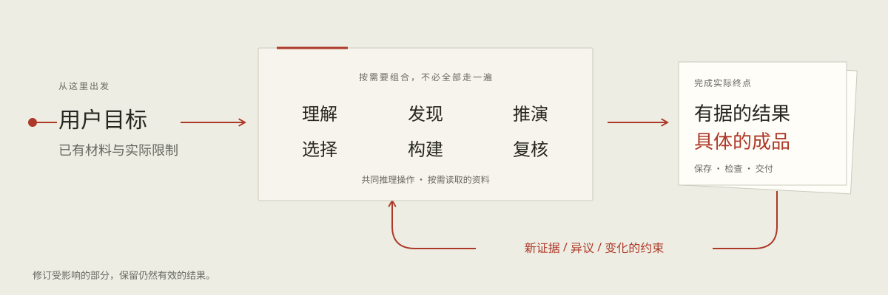

<p align="center">
  
</p>

# Ariadne

### 把复杂问题，做成有据的成果。

Ariadne 为智能体提供一套可以组合的方法。从理解材料、发现遗漏和推演条件，到比较选择、构建成品与复核结果，它帮助工作沿着真实依赖继续推进。你可以得到一份有理由的判断，也可以得到已经写好、保存并检查过的文稿、计划或实现。

**一个安装入口，按任务组织工作。** 不需要先选模块、填完整记录，或把所有步骤走一遍。告诉 Ariadne 你要完成什么、已有材料和实际限制即可。

[开始使用](#开始使用) · [看一个例子](#一个问题怎样成为成果) · [官网](https://xi-kari.github.io/ariadne-skill/) · [方法与架构](docs/architecture.md)

## 你现在要完成什么？

下面是当前可以组合的能力路径。它们提供工作入口，不把问题封闭为六种类型；一个任务可以跨路径，也可以使用更直接的领域方法。

| 你要做的事 | Ariadne 会推进什么 | 路径 |
| --- | --- | --- |
| 读懂材料，解释问题 | 分清概念、事实与解释，找到真正需要说明的差异。 | [理解 understand](skills/ariadne-skill/paths/understand.md) |
| 寻找遗漏和新可能 | 质疑前提，提出反例、新问题、竞争机制或设计候选，并保留来路与检验办法。 | [发现 discover](skills/ariadne-skill/paths/discover.md) |
| 看条件变化会怎样 | 展开相关路径、时钟与分叉，指出哪些观察能够区分它们。 | [推演 project](skills/ariadne-skill/paths/project.md) |
| 比较方案，作出判断 | 说清标准、可行性、受影响位置与代价，给出有前提的推荐。 | [选择 decide](skills/ariadne-skill/paths/decide.md) |
| 写出来、做出来 | 把候选变成可检查的文稿、规则、计划或实现，在已有授权内完成并核验终点。 | [构建 create](skills/ariadne-skill/paths/create.md) |
| 检查与修订已有成果 | 检查依据、推导、反例和实际结果，修正真正受影响的部分。 | [复核 review](skills/ariadne-skill/paths/review.md) |

## 一个问题怎样成为成果

> **虚构教学例。** 以下数据用于说明工作方式，不是实际团队案例，也不是效果评测。

**请求：**“这张八晚值班表每人都是两班，却有人觉得休息太碎。请解释差别，做一版安排，并检查结果。”

原表与候选表如下，每晚只需要一人：

| 第几晚 | 1 | 2 | 3 | 4 | 5 | 6 | 7 | 8 |
| --- | --- | --- | --- | --- | --- | --- | --- | --- |
| 原表 | A | B | A | B | C | D | C | D |
| 候选 | A | B | C | D | A | B | C | D |

工作从具体差异开始：总次数相同，不代表两次值班之间的间隔相同。原表中，每个人的两次值班之间只有 **1 个完整夜晚**；候选表中为 **3 个完整夜晚**。这是八晚窗口内的安排差异，尚不能说明整体负担公平。

Ariadne 在这里组合理解、发现、选择、构建与复核：指出被总次数遮住的区别，保留原表作为比较，做出新表，核对八晚覆盖、每人两班及窗口内间隔。交付的是具体安排和检查结果；采用前仍要结合窗口外排班、工作时长、当事人安排与决定权限。

**接着补充：**“C 在第 3 晚不能值班。”

把第 3、4 晚的 C、D 对调，可以得到 `A B D C A B C D`。覆盖与次数保持不变，窗口内最短间隔变成 **2 个完整夜晚**。新结果保留了部分改善，也明确说明哪项条件改变了原方案；不会把旧方案追认成在新条件下也合格。

[查看示例排班 CSV](site/assets/example-rota.csv) · [在网页中阅读这个例子](https://xi-kari.github.io/ariadne-skill/#example)

## 一条可以接着走的工作线

<p align="center">
  
</p>

共同推理操作支撑每条路径，详细理论合同与工具在需要时进入。路径可以交叉、返回或直接结束；理解本身也可以是完整成果。

- **先确定实际终点。** 是解释清楚、完成草稿、修复程序，还是核对某项外部变化，检查方式随之确定。
- **让依据与主张相配。** 事实、解释、形式结果、模拟和候选分别承担责任。合理竞争项需要比较；没有合理的第二个候选时，说明检索范围和失败条件，不为凑数编造。
- **允许重开问题。** 目标、成员、损失或“给定约束”受到有理由的质疑时，说明新旧问题的关系，保留原结果。
- **继续完成。** 方法本身不产生权限；宿主可以依据用户已有的有效授权，继续写作、构建、保存与检查。方法交接不等于任务完成。
- **按依赖修订。** 新材料只改变真正依赖它的判断；有效的局部结果和用户已有编辑继续保留。

普通任务使用相称的文字和成果即可。正式条件前瞻仍有独立的结果前登记、基线、期限与回写合同；旧 Method Record 2.0／2.1 在显式兼容层中读取，不再是每个任务必须填写的统一表格。详见[架构](docs/architecture.md)与[迁移说明](docs/migration.md)。

## 开始使用

Ariadne 安装为一个完整的 `ariadne-skill`，内部包含能力路径、共同方法和按需读取的资料。推荐先在项目中使用：

```powershell
npx skills add xi-kari/ariadne-skill --skill ariadne-skill --copy -a codex
```

这是项目级安装，`--copy` 也适用于不使用符号链接的 Windows 环境。其他宿主、发现路径与验证方式见[兼容与安装说明](docs/agent-compatibility.md)。不需要分别安装能力路径。

> **版本提示：** 上面的安装命令跟随 `main`。单入口架构的变更记录见 [PR #11](https://github.com/xi-kari/ariadne-skill/pull/11)。稳定标签 `v2.0.0` 对应旧版十入口架构与 Method Record 2.0；需要当前架构时请使用 `main`，旧记录迁移见[迁移说明](docs/migration.md)。

在 Codex 中显式调用：

```text
$ariadne-skill 这是当前方案和两份新材料。
请先判断哪些前提需要修改，再提出可行调整，
把选定方案写成完整稿，并检查它是否满足列出的限制。
```

同一任务的追问可以直接继续：

```text
补充一个限制……
这条解释可能有反例……
保留现有有效内容，把修订并入完整稿。
```

没有 Agent Skills 目录的宿主可使用[单文件捆绑版](dist/ariadne-bundle.md)。它的包含范围和未内联资源以文件内说明为准。

## 来源、责任与验证

方法来源是 Xikari 著《Xikari-条件结构与转化论》**v2（2026-11-16）**，来源 SHA-256 为 `6ef2e508474d4ac1ad07d7e4e068955342c405b5f680afcfc40d68cca3d0149c`。Ariadne 是由理论整理的派生候选，不代表作者逐项确认；理论定义有冲突时回到原文。原文不随本仓库分发。[来源覆盖](docs/source-coverage.md)记录对应关系。

方法可以组织判断，不能代替对象证据、专业判断或当事人的决定权。`authorization_effect: none` 表示方法不签发权限；已有有效授权由宿主工作流据实使用。候选、模拟、工具回执和软件检查各自只证明其实际检验的事项。

本次架构验证另外实际运行了九个合成任务，包含跨回合修订、代码修复、设计交付和前瞻登记；结果、成品、副本哈希及测试限制见[验证记录](evals/evidence/composable-paths-20261117/REPORT.md)。这些会话内行为测试不替代各宿主的安装与发现实测。

工程检查用于核对资源、链接、格式、兼容层与构建一致性，不证明方法优于其他方法，也不把教学例当实效证据：

```powershell
python -X utf8 -B -m pytest -q -p no:cacheprovider
python -X utf8 -B scripts/validate_repo.py
python -X utf8 -B scripts/validate_evals.py
python -X utf8 -B scripts/validate_adapters.py
python -X utf8 -B scripts/build_bundle.py --check
python -X utf8 -B scripts/build_site.py --output build/site
```

[主入口](skills/ariadne-skill/SKILL.md) · [架构](docs/architecture.md) · [迁移](docs/migration.md) · [贡献指南](CONTRIBUTING.md) · [安全政策](SECURITY.md) · [MIT License](LICENSE)
