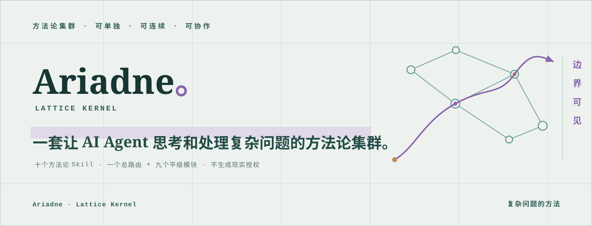
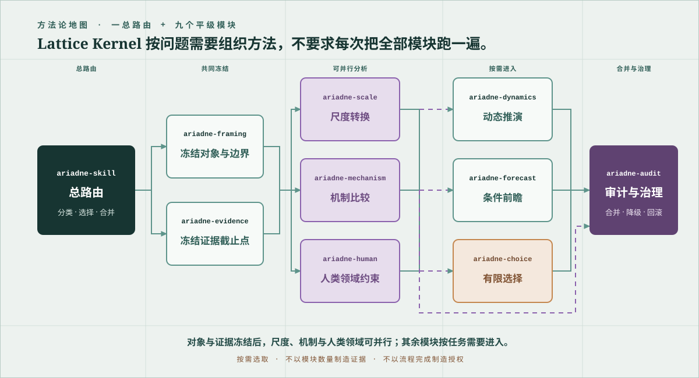

<div align="center">

<a href="docs/assets/readme-hero.svg"></a>

# Ariadne

### 让 AI Agent 有方法地面对复杂问题

**一套让 AI Agent 思考和处理复杂问题的方法论集群。**

<p><sub>十个方法论 Skill 可以单独调用、连续衔接或集群协作；它们共同约束对象、证据、尺度、机制、推演、前瞻、选择与审计。</sub></p>


<p>
  <a href="skills/ariadne-skill/SKILL.md"><b>阅读主 Skill</b></a>
  &nbsp;·&nbsp;
  <a href="#s03"><b>选择方法论</b></a>
  &nbsp;·&nbsp;
  <a href="#s08"><b>开始使用</b></a>
</p>

</div>

<table align="center">
<tr>
<td align="center" width="25%"><br><b>10 个</b><br>方法论 Skill<br><sub>一个总路由<br>九个平级模块</sub><br><br></td>
<td align="center" width="25%"><br><b>5 种</b><br>协作方式<br><sub>单独、连续、集群<br>持续与完整方法运行</sub><br><br></td>
<td align="center" width="25%"><br><b>3 档</b><br>输出上限<br><sub>描述、诊断<br>外部程序要求</sub><br><br></td>
<td align="center" width="25%"><br><b>none</b><br>授权效力<br><sub>方法可以约束推理<br>不能签发现实权限</sub><br><br></td>
</tr>
</table>

> **核心边界：** Ariadne 帮助 Agent 和人把复杂问题变成有边界、可检查、可继续的方法过程。它不是世界本体论、真理引擎、人格裁判、临床工具、价值选择器或现实授权机关。

<br>

<a id="s00"></a>

## 目录

<sub><b>这一页有什么</b></sub>

| § | 章节 | 一句话 |
| :-- | :-- | :-- |
| `§01` | [**Ariadne 是什么**](#s01) | <sub>给 Agent 工作，也给人思考的方法论集群</sub> |
| `§02` | [**Lattice Kernel 方法论地图**](#s02) | <sub>一个总路由如何组织九个平级模块</sub> |
| `§03` | [**十个方法论总览**](#s03) | <sub>先快速找到适合当前任务的 Skill</sub> |
| `§04` | [**每个方法论分别能做什么**](#s04) | <sub>职责、工作、任务、产出与边界逐一说明</sub> |
| `§05` | [**单独、连续与集群工作**](#s05) | <sub>五种运行方式与典型组合</sub> |
| `§06` | [**Method Record 与输出边界**](#s06) | <sub>让判断可续接、可质疑、可降级</sub> |
| `§07` | [**Agent 与人怎样使用**](#s07) | <sub>从完整运行到一张思考检查表</sub> |
| `§08` | [**调用与验证**](#s08) | <sub>显式点名、仓库路径与本地验证</sub> |
| `§09` | [**边界与仓库状态**](#s09) | <sub>当前完成态、发布限制与安全上限</sub> |
| `§10` | [**文档入口**](#s10) | <sub>设计、覆盖与实施依据</sub> |

---

<a id="s01"></a>

## §01 · Ariadne 是什么

<sub><b>方法论集群 · 复杂问题工作系统</b></sub>

Ariadne 面向那些不能只靠一次搜索、一个观点或一条建议解决的问题。它先问清楚对象和边界，再检查材料究竟能支持什么；需要时继续处理尺度转换、竞争机制、人的位置、事件传播、条件前瞻、有限选择与高影响审计。

对 AI Agent 来说，它是一套工作纪律：**知道先做什么、什么时候分工、哪些结果可以合并，以及结论最多能走到哪里。** 对人来说，它也可以是一套思考框架：不必填写所有字段，也可以用单个模块检查问题是否问对、证据是否够、尺度是否偷换、未来判断能否失败、外部授权记录是否覆盖该行动。

Ariadne 的目标不是让回答显得复杂，而是让复杂工作保持几条清楚的线：

- 对象在判断前被声明，名称本身不证明对象存在。
- 来源、材料、观察、证据、反证、判断和外部授权不互相冒充。
- 个体与群体、局部与整体、短期与长期之间的迁移必须记录损失。
- 动态路径、条件前瞻、有限选择和现实授权保持分离。
- 未知、竞争解释、反向信号、停止、申诉、回滚与退役始终可以进入记录。

它不替代学科证据、专业评估、法律程序、组织授权或当事人的决定权。流程走完只表示方法过程留下了记录，不表示世界已经被证明，也不表示任何行动已经获准。

<p align="right"><sub><a href="#s00">↥ 返回目录</a></sub></p>

<a id="s02"></a>

## §02 · Lattice Kernel 方法论地图

<sub><b>一个共同内核 · 九个平级模块 · 按需组织</b></sub>

<a href="docs/assets/lattice-kernel-map.svg"></a>

<p align="center"><sub>图中文字较多；窄屏可以点击图片查看原始尺寸，也可以直接阅读下面的文本地图。</sub></p>

Lattice Kernel 是十个 Skill 共享的方法论内核。`ariadne-skill` 负责识别请求、选择模块和合并结果；其他九个 Skill 都能独立工作，也能通过共同的 Method Record 连续衔接。Ariadne 不要求每个任务完整走一遍固定流水线：只运行当前问题真正需要的模块。

**文本版方法论地图（窄屏与无图环境）：**

```text
复杂请求
  -> ariadne-skill：分类、路由、合并
  -> ariadne-framing：冻结对象与边界
  -> ariadne-evidence：冻结证据截止点
  -> [ariadne-scale | ariadne-mechanism | ariadne-human]：可并行
  -> [ariadne-dynamics | ariadne-forecast | ariadne-choice]：按任务需要
  -> ariadne-audit：高影响审查或集群合并
```

集群工作只有在对象记录和证据截止点完全一致后才开始。合并时，未知会累积，边界冲突会保留，证据等级不会因为多个模块赞同而上升，模块数量也不会产生授权。

<p align="right"><sub><a href="#s00">↥ 返回目录</a></sub></p>

<a id="s03"></a>

## §03 · 十个方法论总览

<sub><b>先看问题缺什么，再选方法</b></sub>

| 方法论 Skill | 主要负责 | 可以处理的工作 |
| :-- | :-- | :-- |
| [`ariadne-skill`](skills/ariadne-skill/SKILL.md) | 方法论总控 | 拆解复杂请求、选择模块、协调连续或集群工作、合并结果 |
| [`ariadne-framing`](skills/ariadne-framing/SKILL.md) | 问题定界 | 冻结对象、边界、变量、接口、时间窗、尺度和任务类型 |
| [`ariadne-evidence`](skills/ariadne-evidence/SKILL.md) | 证据审计 | 来源审计、因果与类比检查、竞争解释、反证和支持上限 |
| [`ariadne-scale`](skills/ariadne-scale/SKILL.md) | 尺度转换 | 个体到群体、局部到整体、短期到长期与跨领域迁移 |
| [`ariadne-mechanism`](skills/ariadne-mechanism/SKILL.md) | 机制比较 | 基线、作用通道、竞争机制、证伪条件和残差分析 |
| [`ariadne-human`](skills/ariadne-human/SKILL.md) | 人类领域约束 | 关系、团队、组织、权力、角色、隐私、责任与意义 |
| [`ariadne-dynamics`](skills/ariadne-dynamics/SKILL.md) | 动态推演 | 事件传播、时钟、阈值、反馈、分支、情景与停止条件 |
| [`ariadne-forecast`](skills/ariadne-forecast/SKILL.md) | 条件前瞻 | 目标、期限、简单基线、校准、反向信号和结果回写 |
| [`ariadne-choice`](skills/ariadne-choice/SKILL.md) | 有限选择 | 比较行动、延期、试验、退出与不行动 |
| [`ariadne-audit`](skills/ariadne-audit/SKILL.md) | 审计与治理 | 强判断闸门、申诉、降级、暂停、回滚、撤回与退役 |

如果问题只缺其中一个方法，直接使用对应 Skill；如果多个环节纠缠在一起，从 `ariadne-skill` 开始。

<p align="right"><sub><a href="#s00">↥ 返回目录</a></sub></p>

<a id="s04"></a>

## §04 · 每个方法论分别能做什么

<sub><b>十个模块 · 五个固定问题</b></sub>

下面每个模块都回答五件事：它负责什么、可以完成什么工作、适合什么任务、产出什么，以及明确不负责什么、何时交给下一模块。

<a id="m01"></a>

### 01 · 方法论总控 · [`ariadne-skill`](skills/ariadne-skill/SKILL.md)

| 字段 | 内容 |
| :-- | :-- |
| **负责什么** | 把复杂请求转成有边界、可检查、可继续的方法运行；决定输出类型、冻结对象与证据、按需调度并合并模块。 |
| **可以完成** | 拆解复合任务；组织单独、连续或集群协作；保留冲突、未知和记录谱系；控制最终输出上限。 |
| **适合任务** | 同时涉及证据、尺度、机制、人、动态、前瞻、行动或审计的复杂研究、组织分析、战略问题与高影响议题。 |
| **典型产出** | 一份普通人能读的有界判断，以及可选的 Method Record：对象、证据截止点、主张、反证、模块运行、冲突和下一步。 |
| **边界** | 不是本体论、真理引擎、人格裁判、临床工具、价值选择器或授权机关；模块齐全和意见一致都不能制造证据或权限。单一方法缺口转交对应平级模块，高影响或集群合并转交 `ariadne-audit`。 |

<a id="m02"></a>

### 02 · 问题定界 · [`ariadne-framing`](skills/ariadne-framing/SKILL.md)

| 字段 | 内容 |
| :-- | :-- |
| **负责什么** | 在判断前说明“现在问的是什么、分析的候选对象是什么”。 |
| **可以完成** | 区分解释、诊断、动态推演、条件前瞻、有限选择、干预审查和治理审查；冻结边界、变量、关系、接口、时间窗、尺度与同一性判据。 |
| **适合任务** | 对象模糊、范围有争议、解释和行动混在一起，或一个群体、系统、阶段只凭名称就被当成现实对象的任务。 |
| **典型产出** | 对象合同、请求类型、候选对象陈述、未决边界、显式未知和后续模块建议。 |
| **边界** | 完整字段只是可讨论声明，不证明对象真实、稳定或有效；证据问题转交 `ariadne-evidence`，尺度、机制、人类风险、行动和高影响审查分别转交对应模块。 |

<a id="m03"></a>

### 03 · 证据审计 · [`ariadne-evidence`](skills/ariadne-evidence/SKILL.md)

| 字段 | 内容 |
| :-- | :-- |
| **负责什么** | 判断现有材料究竟能把每个主张支持到什么程度。 |
| **可以完成** | 冻结证据截止点；区分来源、材料、观察、证据、反证、判断和外部授权；审计因果、类比、根实例、零结果与竞争解释。 |
| **适合任务** | 文献与引文核查、数据或访谈审计、因果主张、相关关系、跨案例类比、反证处理和证据强度判断。 |
| **典型产出** | 证据链、主张账本、支持与反证 ID、竞争解释、证据缺口、可撤回条件和支持上限。 |
| **边界** | 不把相关性、先后顺序或顺畅故事当成因果；不从事实自动生成价值、责任、建议或授权。价值与行动问题转交 `ariadne-choice`，高影响使用转交 `ariadne-audit`。 |

<a id="m04"></a>

### 04 · 尺度转换 · [`ariadne-scale`](skills/ariadne-scale/SKILL.md)

| 字段 | 内容 |
| :-- | :-- |
| **负责什么** | 审计对象、观察、主张或行动在不同尺度、圈层、表征和词汇之间移动时，什么被保留、改变、丢失或变得不可比。 |
| **可以完成** | 比较九维尺度；区分扩张、收缩、混合、不可比和未知；登记转换算子、同一性、映射证据、误差与残差。 |
| **适合任务** | 个体到群体、局部到整体、短期到长期、单位到组织、网络传播、材料压缩、跨领域类比和概念换译。 |
| **典型产出** | 两端尺度剖面、尺度或转义记录、保持与损失清单、映射见证、失败桥接和残差。 |
| **边界** | 不从群体统计反推每个个体；不把嵌套、传播、代表与授权混为一谈；不跨尺度搬运价值、责任或权限。因果解释、人类风险和行动治理分别转交机制、人类、选择或审计模块。 |

<a id="m05"></a>

### 05 · 机制比较 · [`ariadne-mechanism`](skills/ariadne-mechanism/SKILL.md)

| 字段 | 内容 |
| :-- | :-- |
| **负责什么** | 回答“为什么、通过什么通道发生”，并让多个机制在同一基线下竞争。 |
| **可以完成** | 建立最简单充分基线；定位残差；构造竞争机制；登记通道观察、区分性预测、反向条件、证伪条件、适用条件与未解释部分。 |
| **适合任务** | 根因分析、结构诊断、反馈与学习、负荷与恢复、阈值变化、筛选与维持，以及因果或类比机制分析。 |
| **典型产出** | 简单基线、至少两个竞争机制、通道与条件、证伪规则、残差比较和有界诊断。 |
| **边界** | 少于两个完整候选时只能停在描述；不分配价值、责任、义务、补救或行动权限。事件路径转交 `ariadne-dynamics`，有期限未来主张转交 `ariadne-forecast`，行动问题转交选择或审计。 |

<a id="m06"></a>

### 06 · 人类领域约束 · [`ariadne-human`](skills/ariadne-human/SKILL.md)

| 字段 | 内容 |
| :-- | :-- |
| **负责什么** | 分析人、关系、团队、组织、制度、权力、隐私、角色、责任和意义，同时避免把人固定标签化。 |
| **可以完成** | 区分角色、圈层和多圈层联合对象；记录慢中快变量、物质与意义条件、隐私与用途；检查直接、间接、低权力和无退出位置。 |
| **适合任务** | 人际关系、团队冲突、组织结构、制度权力、隐私与同意、角色责任、群体互动和多圈层问题。 |
| **典型产出** | 受影响位置清单、角色与圈层记录、隐私状态、替代解释、用途限制和负责的人类复核要求。 |
| **边界** | 不做人格本质判断或临床诊断；不把集体当成人；不从沉默、拒绝、可见性或成员身份推断意图、同意或责任。机制、事件、行动和高影响使用分别转交对应模块。 |

<a id="m07"></a>

### 07 · 动态推演 · [`ariadne-dynamics`](skills/ariadne-dynamics/SKILL.md)

| 字段 | 内容 |
| :-- | :-- |
| **负责什么** | 从冻结状态推导事件如何沿通道、时钟、阈值和反馈形成条件路径。 |
| **可以完成** | 建立事件合同与联合状态；构造条件分支；区分并行、互斥和不可比路径；运行场景、反事实与递归模拟；登记信号、残差和停止条件。 |
| **适合任务** | 事件传播、级联风险、组织或制度演化、危机路径、场景规划、反事实分析和递归模拟。 |
| **典型产出** | 冻结快照、事件事实状态、条件分支图、时钟、早期与反向信号、残差、变量候选、停止记录和回写计划。 |
| **边界** | 模拟深度、样本数和叙事连贯性不会增加现实证据；不把计划、假设或模拟事件写成已观察事实。有目标与期限的未来主张转交 `ariadne-forecast`，行动与高影响使用转交选择或审计。 |

<a id="m08"></a>

### 08 · 条件前瞻 · [`ariadne-forecast`](skills/ariadne-forecast/SKILL.md)

| 字段 | 内容 |
| :-- | :-- |
| **负责什么** | 在结果出现前登记可评价、可校准、可失败的未来主张。 |
| **可以完成** | 冻结目标、期限、输入与观察规则；建立公平简单基线；登记概率、区间、排序、方向或放弃；预先定义校准、信号、暂停和退役条件。 |
| **适合任务** | 有明确目标与期限的风险判断、趋势判断、条件预测、模型增量价值比较和递归前瞻。 |
| **典型产出** | 前瞻登记、目标与期限、基线、条件路径、表达强度、早期与反向信号、失败语义、校准和结果回写。 |
| **边界** | 没有可判定目标或期限时只能做场景；不事后伪造预登记，不凭文字生成概率，不宣称必然性，也不把准确性兑换成行动权限。行动问题转交 `ariadne-choice`，高影响或公开使用转交 `ariadne-audit`。 |

<a id="m09"></a>

### 09 · 有限选择 · [`ariadne-choice`](skills/ariadne-choice/SKILL.md)

| 字段 | 内容 |
| :-- | :-- |
| **负责什么** | 比较行动、延期、可逆试验、退出与不行动，同时把事实、价值、权利和授权分开。 |
| **可以完成** | 区分系统筛选、主体选择与治理选择；建立稳定选项集并保留 `no_action`；比较后果、分配、信息价值、可逆性、锁定和残余伤害。 |
| **适合任务** | 项目决策、组织方案、试点设计、治理选择、延期或退出判断，以及“是否行动”的有限比较。 |
| **典型产出** | 选项比较、价值冲突、受益与负担分布、保护底线、外部程序要求、停止、申诉、回滚和补救条件。 |
| **边界** | 不替主体选择价值，不从沉默或未退出推断同意，不签发授权、不执行方案，也不保证成功。任何外部或领域应用在使用前转交 `ariadne-audit`。 |

<a id="m10"></a>

### 10 · 审计与治理 · [`ariadne-audit`](skills/ariadne-audit/SKILL.md)

| 字段 | 内容 |
| :-- | :-- |
| **负责什么** | 判断高影响结论、自动化输出、公共主张、治理过程或 Ariadne 记录能否保留当前判断与使用上限。 |
| **可以完成** | 执行转换闸、主闸、强判断与动态闸；审查 AI 边界、异议、申诉、反报复、独立复核、回滚、补救、暂停、撤回、替代与退役。 |
| **适合任务** | 公共发布、自动化判断、组织或制度使用、难逆决策、干预审查、治理变更，以及完整 Ariadne 链路终审。 |
| **典型产出** | 闸门状态、失败与未运行项、冲突、降低后的输出上限、可申诉性、纠正与回滚目标、补救和权威回写要求。 |
| **边界** | 闸门通过只说明程序条件通过，不证明现实、有效性、安全、同意或授权；AI 不能自证，审计不能自批或自行授权。对象、证据、尺度、用途或权限范围改变时，回到最早受影响模块重跑。 |

<p align="right"><sub><a href="#s00">↥ 返回目录</a></sub></p>

<a id="s05"></a>

## §05 · 单独、连续与集群工作

<sub><b>五种方式 · 同一组边界</b></sub>

| 方式 | 怎样工作 | 适合什么情况 |
| :-- | :-- | :-- |
| **单独** | 一个模块创建最小 Method Record，只完成自己的方法职责 | 问题明确缺少某一环，如证据审计或尺度检查 |
| **连续** | 后一模块消费前一模块记录，按任务依次衔接 | 需要从定界走到机制、推演、前瞻或选择 |
| **集群** | 对象和证据冻结后，多个平级模块并行工作，由审计合并 | 尺度、机制和人的位置可以独立检查的复杂任务 |
| **持续** | 新材料或新范围产生新版本，保留父记录和变化原因 | 长期研究、项目推进、前瞻结果回写与复盘 |
| **完整方法运行** | 总路由运行所有真正适用的模块 | 高影响、跨模块且需要完整方法记录的任务 |

没有多智能体能力时，集群模式会退化为相同模块的顺序执行；合同、输出上限和最终结果集合不应因此改变。

常见组合：

```text
研究主张审计  framing -> evidence -> scale / mechanism -> audit
组织问题分析  framing -> evidence -> human + mechanism -> dynamics -> choice -> audit
条件前瞻      framing -> evidence -> scale + mechanism -> dynamics -> forecast
有限选择      framing -> evidence -> human -> choice -> audit
AI 输出复核   framing -> evidence -> audit
```

这些链路是路由示例，不是必须照抄的固定流水线。前瞻任务不自动进入选择，选择任务也不自动获得现实授权。

<p align="right"><sub><a href="#s00">↥ 返回目录</a></sub></p>

<a id="s06"></a>

## §06 · Method Record 与输出边界

<sub><b>可续接记录 · 不是现实数据库或授权令牌</b></sub>

Method Record 用来保存请求类型、对象状态、证据截止点、尺度范围、主张、反证、模块输入输出、未知、冲突与下一步。它让后续 Agent 知道上一轮做了什么、凭什么、在哪个版本上做，以及哪些地方不能继续抬高结论。

```text
record_id
schema_version
record_version
lineage_kind
parent_record_id
parent_records
request_type
object_contract
evidence_cutoff
scale_scope
claim_ledger
rule_registry
unknowns_and_counterevidence
module_runs + module_payloads
output_ceiling
ceiling_transition
recommended_next_modules
authorization_effect
```

完整字段、父子版本和合并规则见 [`method-record.md`](skills/ariadne-skill/references/method-record.md)。普通子记录只能保持或降低上限；只有相对精确父记录新增了可解析证据或已满足协议时，才可凭明确依据升档；多父合并只能使用有序最小值。模块完成、模块一致、模拟次数或叙事流畅都不能抬高输出上限。

| 输出上限 | 可以做什么 | 不能冒充什么 |
| :-- | :-- | :-- |
| `description_only` | 陈述材料、候选对象、未知和补证方向 | 不能冒充结构诊断 |
| `diagnostic_only` | 给出有边界的证据或机制诊断 | 不能冒充现实处置要求 |
| `requirements_only` | 说明外部复核、保护、停止或纠正需要满足的条件 | 不能冒充已授权命令 |

`authorization_effect` 始终为 `none`。即使模块检查到一份外部授权记录，它也只能核对记录是否覆盖当前主体、对象、行动、范围和期限，不能替代签发者产生新的权限。

<p align="right"><sub><a href="#s00">↥ 返回目录</a></sub></p>

<a id="s07"></a>

## §07 · Agent 与人怎样使用

<sub><b>既可以运行，也可以拿来检查思路</b></sub>

### 给 AI Agent

- 面对多环节复杂任务，从 `ariadne-skill` 开始，让总路由选择最小充分模块集。
- 已经知道缺口时，直接点名专项 Skill，例如用 `ariadne-evidence` 审计证据，用 `ariadne-scale` 检查跨尺度跳跃。
- 多智能体协作时，先把同一份对象记录、证据截止点、原始任务和输出字段交给各模块，不给偏好结论。
- 合并结果时保留冲突与未知，不用投票提高证据等级。

### 给人

- 写研究结论前，用 framing 问“对象到底是什么”，用 evidence 问“材料能证明到哪里”。
- 做组织或关系判断时，用 human 检查角色、权力、隐私、低权力位置与退出条件。
- 谈未来时，用 dynamics 展开条件路径，再用 forecast 冻结目标、期限、基线和失败条件。
- 做决定时，用 choice 把做、等、试、退和不做放在同一基线上，再让 audit 检查申诉、停止和回滚是否真实。

非正式、低影响的个人思考可以只使用一张模块检查表。正式条件前瞻、现实选择、审计、跨智能体交接，以及高影响、公共、自动化或难以逆转的使用，必须暴露对应的完整登记或载荷。

<p align="right"><sub><a href="#s00">↥ 返回目录</a></sub></p>

<a id="s08"></a>

## §08 · 调用与验证

<sub><b>全局分发语义 · 当前电脑显式调用</b></sub>

克隆仓库：

```powershell
git clone https://github.com/xi-kari/ariadne-skill.git
cd ariadne-skill
```

Ariadne 的分发目标是让支持 Agent Skills 的宿主依据每个模块的职责描述进行语义路由。当前电脑不把开发仓库写入全局 Skill 目录，因此本地开发和评测只使用显式 Skill 名或直接仓库路径。

示例：

```text
$ariadne-skill 把这个复杂项目问题拆成完整的方法论工作流
$ariadne-framing 先确定这个“用户流失”问题究竟在分析什么
$ariadne-evidence 审计这些材料能否支持因果结论
$ariadne-scale 检查能否从几个个体案例推到整个组织
$ariadne-mechanism 比较至少两个竞争机制和它们的证伪条件
$ariadne-forecast 把这个未来判断登记成有期限、可失败的前瞻
$ariadne-choice 比较行动、延期、试验、退出和不行动
$ariadne-audit 审查这份高影响结论能否公开或自动化使用
```

仓库验证：

```powershell
python -X utf8 -B -m pytest -q
python -X utf8 -B scripts/validate_repo.py
python -X utf8 -B scripts/validate_evals.py
```

<p align="right"><sub><a href="#s00">↥ 返回目录</a></sub></p>

<a id="s09"></a>

## §09 · 边界与仓库状态

<sub><b>内容已完成 · 发布仍受边界约束</b></sub>

<!-- ariadne-stage-status:start -->
| Phase | Status |
|---|---|
| RED_BASELINE | complete |
| BUILD_ALL_CONTENT | complete |
| WHOLE_SUITE_CONTENT_COMPLETE | complete |
| INTEGRATED_REVIEW | complete |
| WHOLE_SUITE_REPAIR | complete |
| WORKER_FINAL_VALIDATION | complete |
| PARENT_INDEPENDENT_VALIDATION | complete |
| RELEASE | not_authorized |
<!-- ariadne-stage-status:end -->

十个 Skill 的完整内容、统一审查、集中修复和独立验证已经完成。公开仓库不等于已经授权 Release tag、包发布或当前电脑的全局安装；这些动作仍需单独授权。

Ariadne 不能替代法律、医疗、财务、心理危机处置、正式调查、机构审查、专业评估或当事人决定。尤其不能：

- 依据少量材料给人固定人格、临床或道德标签。
- 把相关性、时序、类比、模拟或模型一致意见写成现实因果。
- 把群体统计直接分配给个体，或把观察范围扩大解释为权限扩大。
- 把条件路径写成必然预言，把前瞻准确率写成统治资格。
- 从事实自动推出价值，从诊断自动推出责任，从比较自动推出命令。
- 用“有申诉”“可回滚”等文字代替现实中可触达、能改变结果的程序。

证据不足、边界改变、反例出现、身份条件变化或保护程序失效时，降级、暂停、不行动、撤回、替代与退役都是正常结果。

<p align="right"><sub><a href="#s00">↥ 返回目录</a></sub></p>

<a id="s10"></a>

## §10 · 文档入口

<sub><b>设计、覆盖与实施依据</b></sub>

| 文档 | 内容 |
| :-- | :-- |
| [主 Skill](skills/ariadne-skill/SKILL.md) | 总路由、完整方法运行、集群合并与输出合同 |
| [Lattice Kernel 设计说明](docs/superpowers/specs/2026-08-03-ariadne-lattice-kernel-design.md) | 产品身份、架构、共同不变量与源边界 |
| [Lattice Kernel 实施计划](docs/superpowers/plans/2026-08-03-ariadne-skill-implementation.md) | 全部内容完成后统一审查的原始建设顺序 |
| [README 重设计说明](docs/superpowers/specs/2026-08-04-ariadne-readme-redesign.md) | 本页的中文内容与 C「理性格点」视觉规格 |
| [README 实施计划](docs/superpowers/plans/2026-08-04-ariadne-readme-redesign.md) | 完整建设、统一审查与验证步骤 |
| [方法论源覆盖](docs/source-coverage.md) | v8.2 方法论区域与十个 Skill 的职责映射 |

源 DOCX 不随公开仓库分发。Ariadne 的公开内容以仓库内 Skill 合同、共同引用、schema、冻结评测和验证器为准。

<p align="right"><sub><a href="#s00">↥ 返回目录</a></sub></p>

<br>

<div align="center">

<sub><b>ARIADNE · LATTICE KERNEL</b></sub>

<sub>方法可以让复杂问题更可检查，但不会替现实证据、价值选择和合法授权作决定。</sub>

</div>
